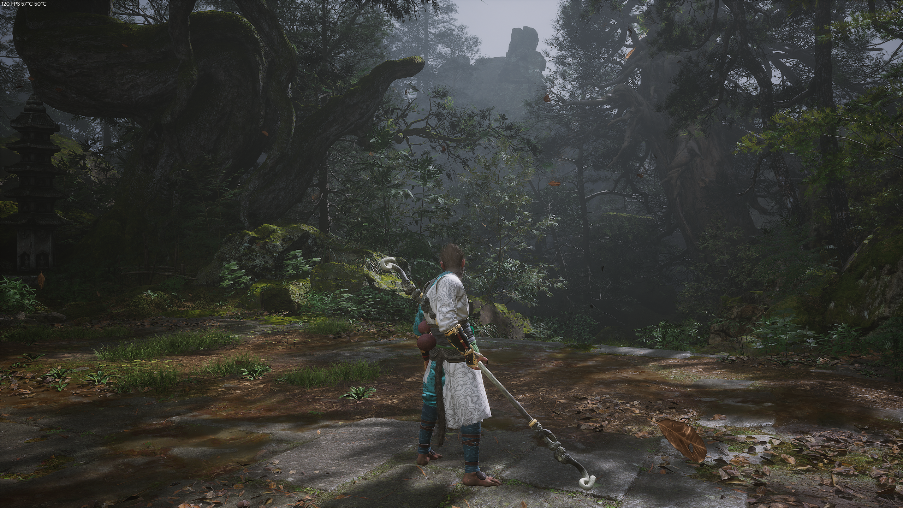
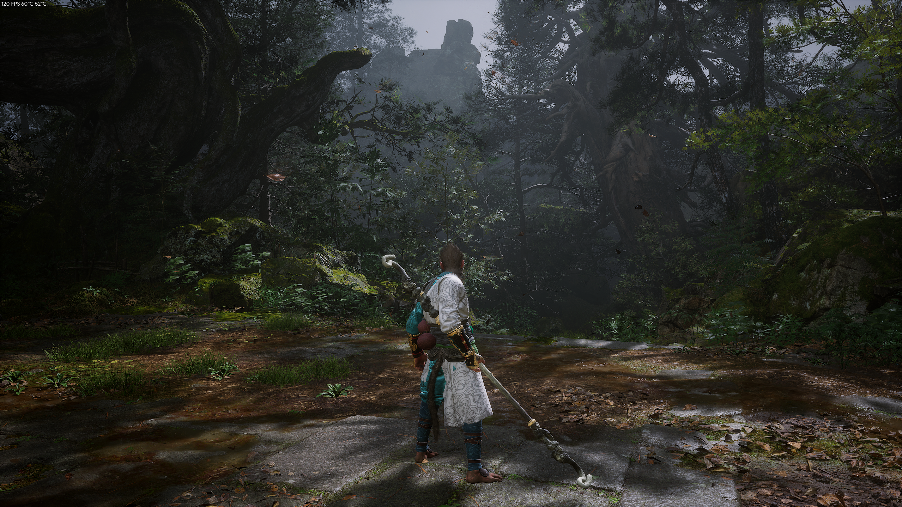
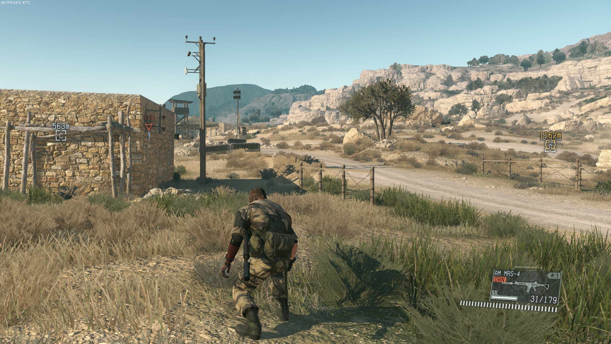
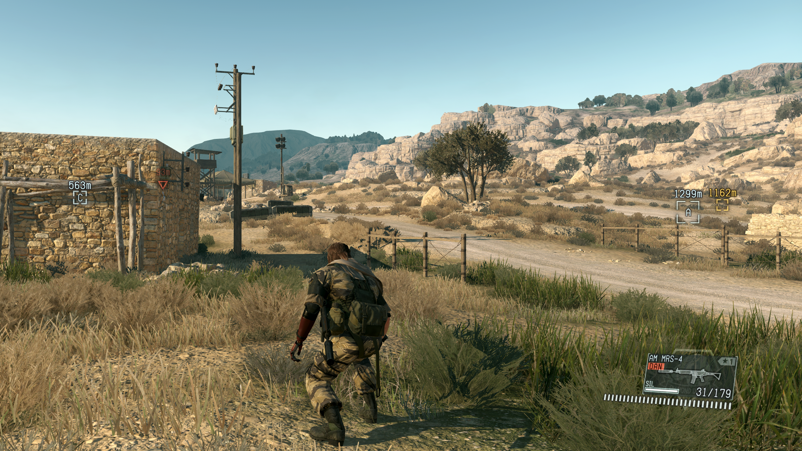
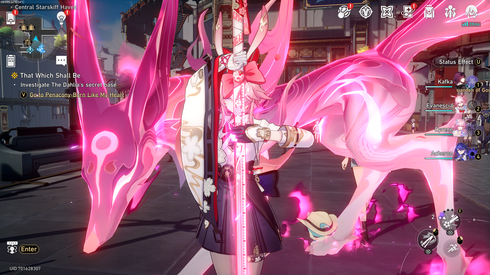
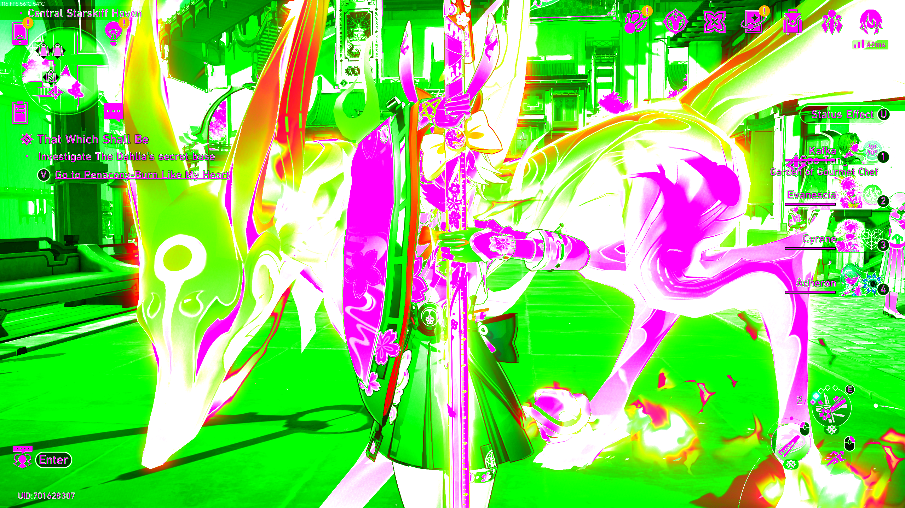

# vkSumi

A Vulkan layer for runtime color grading on Linux. Brightness, contrast, saturation, hue, gamma, temperature, tint, RGB gain, 3-band lift/gain. Live `.conf` file with hot reload. Per-game configs. An Adrenalin / NVIDIA Freestyle equivalent.

Made because vkBasalt is unmaintained and the only other option is ReShade -> wine -> inject -> pray (waste of time for some minor tweaks, ain't installing all that.) and whatever mentally ill LUTs were needed for vkBasalt.

> Little note that this does NOT replace VkBasalt's other functionalities (such as CAS, Denoise, etc.), this is purely for color grading sliders.

## Screenshots


| Before                                         | After                                |
|:---|:---|
|    |  |
|      |  |
|      |  |


## Installation / Build


#### AUR

```fish
yay -S vksumi
```

#### Flatpak

You can install it manually for now. Grab one or both `.flatpak` files in the [releases page](https://github.com/reakjra/vkSumi/releases) and then run in your terminal: 

```bash
flatpak install vkSumi-24.08.flatpak 
# or
flatpak install vkSumi-25.08.flatpak 
```

#### Manual building

```fish
meson setup builddir --prefix="$HOME/.local"
ninja -C builddir
meson install -C builddir
```

Drops the `.so` in `~/.local/lib/`, the layer manifest in `~/.local/share/vulkan/implicit_layer.d/`, and the toggle script in `~/.local/bin/`.


## Use

The layer only activates when `ENABLE_VKSUMI=1` is set, otherwise it's invisible.

Native Linux:
```fish
env ENABLE_VKSUMI=1 some-vulkan-game
```

Steam (any game) - right-click -> Properties -> Launch Options:
```
ENABLE_VKSUMI=1 %command%
```

## Config

Lives at `~/.config/vkSumi/vkSumi.conf` (global) and `~/.config/vkSumi/games/<exe-name>.conf` (per-game, auto-created on first launch).

> Per-game files merge on top of global only set what you want different.

```ini
enabled     = true
compare     = false    # original on the left and graded on the right
toggle_keys = Shift_R+F9

brightness  = 0.0    # [-1 .. 1]
contrast    = 0.0    # [-1 .. 1]
exposure    = 0.0    # EV stops
saturation  = 0.0    # -1 = grayscale
vibrance    = 0.0    # smarter saturation
hue_deg     = 0.0    # [-180 .. 180]
gamma       = 0.0    # + brightens midtones
temperature = 0.0    # warm (+) cool (-)
tint        = 0.0    # magenta (+) green (-)

red_gain    = 0.0
green_gain  = 0.0
blue_gain   = 0.0

shadows     = 0.0    # to increase shadows depth go negative (-)
midtones    = 0.0
highlights  = 0.0

red_saturation     = 0.0    # [-1 .. 1], only that hue changes
yellow_saturation  = 0.0
green_saturation   = 0.0
cyan_saturation    = 0.0
blue_saturation    = 0.0
magenta_saturation = 0.0

shadow_tint        = 0.0    # [0 .. 1]
shadow_tint_hue    = 190    # [0 .. 360]
highlight_tint     = 0.0    # [0 .. 1]
highlight_tint_hue = 35     # [0 .. 360]

vignette    = 0.0    # [0 .. 1], darkens toward the corners

daltonize          = off    # off | protan | deutan | tritan
daltonize_severity = 1.0    # [0 .. 1]
daltonize_strength = 1.0    # [0 .. 1]

# privacy censor for UIDs and names, censor0 to censor7
censor0.x        = 0.88        # top-left corner, 0..1 of the screen
censor0.y        = 0.975
censor0.w        = 0.12        # size, 0..1 of the screen
censor0.h        = 0.025
censor0.shape    = rect        # rect | ellipse
censor0.mode     = pixelate    # pixelate | blur | fill
censor0.strength = 22          # block size or blur radius in pixels
censor0.feather  = 0.2         # soft edge around the box, 0..1

PER_GAME_CONFIG_CREATION=true     # per-game .conf file creation (true by default)
VKSUMI_CONFIG_FILE=path/to/.conf  # path to another .conf file that act as a global substitute
```

See `vkSumi.conf.example` for the full annotated version.

Envs: 

| Env | What it does?! |
|:---|:---|
| `ENABLE_VKSUMI=1` | turns the layer on |
| `DISABLE_VKSUMI=1` | forces it off, wins over `ENABLE_VKSUMI` |
| `VKSUMI_CONFIG_FILE=path/to/.conf` | extra conf merged on top of everything else (per-game and global) |
| `VKSUMI_DEBUG=1` | logs every layer call to stderr |

## Hotkey

Two ways:

**In-layer** (X11 + XWayland, so Wine/Proton games work):
Set `toggle_keys = Shift_R+F9` in the conf. Press the combo while the game window is focused. Format is "+"-separated X11 keysym names (full list in `/usr/include/X11/keysymdef.h`).

**Script + compositor bind**:
```
# Hyprland (~/.config/hypr/hyprland.conf)
bind = SHIFT, F9, exec, vksumi-toggle

# sway (~/.config/sway/config)
bindsym Shift+F9 exec vksumi-toggle
```

## Debugging

```fish
ENABLE_VKSUMI=1 VKSUMI_DEBUG=1 some-game
```
Dumps every layer call to stderr (pray)

## Credits

Architecture lifted from [vkBasalt](https://github.com/DadSchoorse/vkBasalt) (RIP).
[MangoHud](https://github.com/flightlessmango/MangoHud)'s code helped figure out a few stuff.

## License

MIT.
